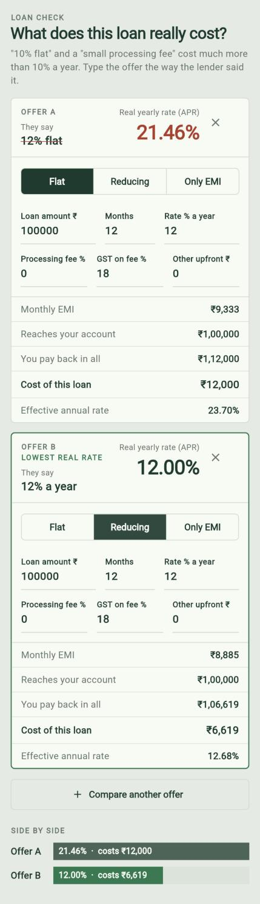

# Loan APR Calculator

Finds the real yearly interest rate behind a loan offer, and compares up to three offers side by side. The numbers you type never leave your device, and there is no account. The Android app works with no internet at all; the web version needs a connection to load the page.

For anyone who has been told "only 12% flat, small processing fee" and wants to know what that costs per year.



<sub>The same "12%" two ways: flat is really 21.46% a year and costs ₹12,000 on ₹1,00,000; reducing is 12% and costs ₹6,619.</sub>

## What it does

- Takes an offer as **flat rate**, **reducing-balance rate**, or **only the EMI** (some lenders and shops quote nothing else).
- Adds the **processing fee**, **GST on the fee** (18% by default, editable) and any **other upfront charge** (insurance, documentation).
- Works out the monthly EMI, the amount that actually reaches your account, the total you repay and the total cost of the loan.
- Works out the **real yearly rate (APR)**: the monthly rate that makes the money you receive equal to the EMIs you pay, times 12. It also shows the effective annual rate, which includes monthly compounding.
- Compares up to three offers and marks the one with the lowest real rate.

Example: 1,00,000 for 12 months at 10% flat has an EMI of about 9,167. That is roughly an 18% yearly rate on the balance you actually owe, because you pay interest on the full amount while the balance falls every month.

## What it does not do

- It does not know any lender's real terms. It only does the arithmetic on the numbers you type.
- It does not model prepayment, part-payment, late fees, floating rates or moratoriums.
- Comparing APR is fair when offers have a similar amount and tenure. For very different tenures, look at total cost as well. Both are shown.
- It is a calculator, not financial advice. The key fact statement from your lender is the official figure.

## Run it

```bash
flutter pub get
flutter run -d chrome        # web
flutter run                  # Android device or emulator
flutter test
```

Web version: https://chandrachaan.github.io/loan-apr-calculator/

Android: APKs are attached to [Releases](https://github.com/ChandraChaan/loan-apr-calculator/releases) when a `v*` tag is pushed. They are signed with the debug key, so Android will ask you to allow installing from outside the Play Store. The release build has no internet permission.

## Project layout

| Path | What it holds |
|---|---|
| `lib/src/loan.dart` | The maths: EMI formulas and the rate solver. Pure Dart. |
| `lib/src/home_page.dart` | The single screen. |
| `test/loan_test.dart` | Maths checks, including a round trip: discounting the EMIs at the computed APR gives back the cash received. |

## License

MIT. Copyright (c) 2026 Chandra ObulaReddy.
